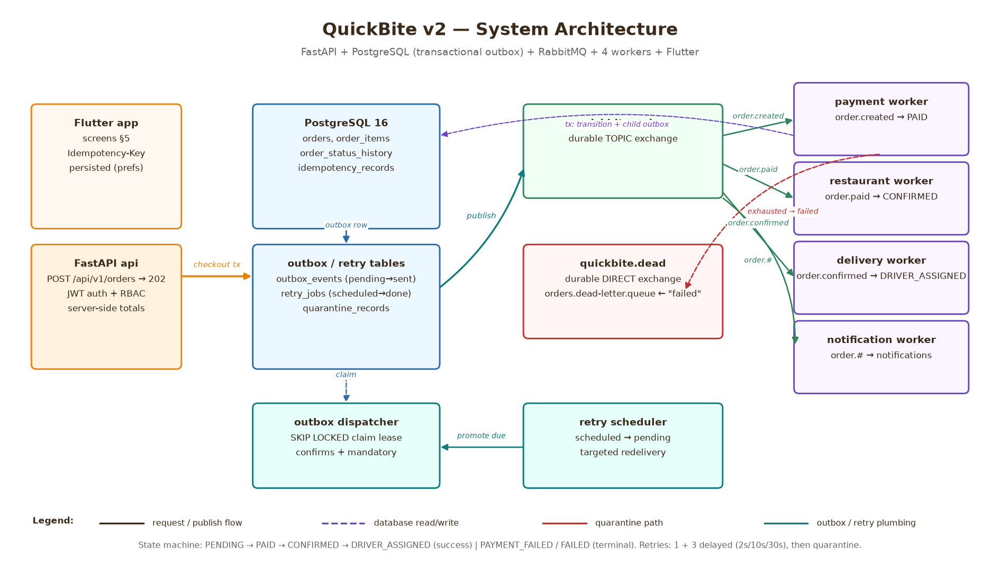

# QuickBite v2 — Architecture


*(generated by `scripts/make_architecture_diagram.py` — re-run it after any topology change)*

## Components

| Component | Implementation | Role |
|---|---|---|
| Flutter app | `frontend/` (separate track) | Web / Android / iOS client. REST over HTTPS; `API_BASE_URL` is public config (`--dart-define`), not a secret. |
| API service | `backend/app/` (FastAPI, `api` in compose) | Versioned REST (`/api/v1`), JWT auth + RBAC, server-side checkout totals, transactional outbox. Never publishes to the broker inline. |
| PostgreSQL 16 | `postgres:16.6` (compose) | Authoritative store: orders, items, history, users, restaurants, menus, drivers, payments, assignments, notifications, idempotency records, processed events, outbox events, retry jobs, quarantine records. |
| RabbitMQ 3.13 | `rabbitmq:3.13-management` (compose) | Durable topic exchange `quickbite.orders`; durable direct exchange `quickbite.dead`. |
| Outbox dispatcher | `backend/app/messaging/outbox.py` | Claims due outbox rows (`SELECT … FOR UPDATE SKIP LOCKED` + claim lease, safe for N dispatchers) and publishes with **publisher confirms + mandatory routing**; marks `sent` only after a confirm with no basic-return. |
| Retry scheduler | `workers/retry_scheduler.py` | Flips due retry rows from `scheduled` to `pending` so the dispatcher publishes them. |
| payment / restaurant / delivery / notification workers | `workers/*_worker.py` | One queue each; manual acks; bounded retries; quarantine. |
| Web host | `web` (nginx, `infra/nginx.conf`) | Serves the Flutter web build (`frontend/build/web`) with SPA deep-link fallback; optionally reverse-proxies `/api/` to the API service. |

## Topology (assignment §9)

```
quickbite.orders (durable TOPIC)
 ├─ payment.queue      <- order.created
 ├─ restaurant.queue   <- order.paid
 ├─ delivery.queue     <- order.confirmed
 └─ notification.queue <- order.#        # NOT order.* — must catch order.payment.failed,
                                         # order.driver.assigned (multi-segment)

quickbite.dead (durable DIRECT)
 └─ orders.dead-letter.queue <- "failed"
```

All queues are durable, non-exclusive, non-auto-delete, and are declared by
every service at startup (`declare_topology` in
`backend/app/messaging/topology.py`), so stopping a consumer never removes its
queue.

## Request / event flow

1. **Checkout** — `POST /api/v1/orders` validates, prices server-side, and
   commits **one PostgreSQL transaction**: order + order items (menu
   snapshots) + initial history (`PENDING`, version 1) + idempotency record +
   outbox event (`order.created → quickbite.orders`). Returns `202` with
   `Location`. The broker is never touched in the request path.
2. **Dispatch** — the outbox dispatcher claims the row, publishes with
   confirms + mandatory routing, marks it `sent`. A crash between publish
   and mark-sent can duplicate; consumers are idempotent, so this is safe.
3. **Payment** — `payment.queue` → worker locks the order row, applies
   `PENDING → PAID` (or `→ PAYMENT_FAILED` on exhaustion), inserts the
   payment row + child outbox event (`order.paid`) in the same transaction,
   commits, then acks. Transient failure → roll back, persist a `retry_jobs`
   row + a **targeted** outbox publication (default exchange → the failing
   queue directly, never re-fan-out through the domain exchange), then ack the
   original.
4. **Restaurant** — `order.paid` → `PAID → CONFIRMED` (+ `order.confirmed`)
   or `→ FAILED` on permanent decline.
5. **Delivery** — `order.confirmed` → assigns the least-loaded active driver,
   `CONFIRMED → DRIVER_ASSIGNED` (+ `order.driver.assigned`).
6. **Notification** — bound to `order.#`, so it sees every event; persists
   `{customer_id, event_id}`-unique notifications. Failures here **never**
   change order status; exhaustion only quarantines.
7. **Retries** — 1 initial attempt + 3 delayed retries (default `2,10,30` s via
   `RETRY_DELAYS_S`), then quarantine: a `quarantine_records` row + terminal
   transition + terminal event + publication to `quickbite.dead` with key
   `"failed"`.

## Reliability boundaries

* **Ack boundary:** commit first, ack after. A crash after commit but before
  ack redelivers; the worker's state/version check (`order already PAID`,
  `processed_events` dedup) turns it into a safe no-op.
* **Business-transaction failure** (could not even schedule a retry): the
  message is left **unacked**, the channel is closed, and the worker
  reconnects with backoff. Never a tight nack/requeue loop.
* **Exactly-once is never claimed** — at-least-once delivery with single
  committed effects (idempotent consumers + state machine + unique
  constraints).

See [ENGINEERING_REPORT.md](ENGINEERING_REPORT.md) for the full reliability,
deduplication, outbox-recovery, security, and scaling analysis.
